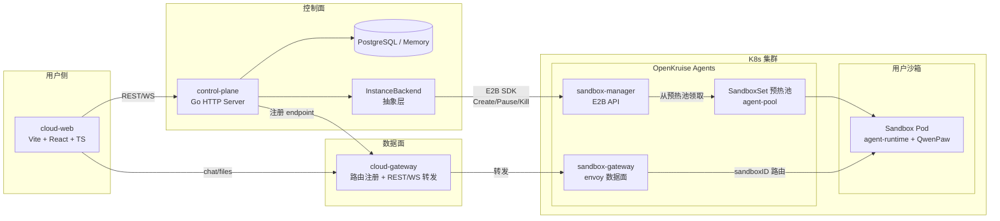
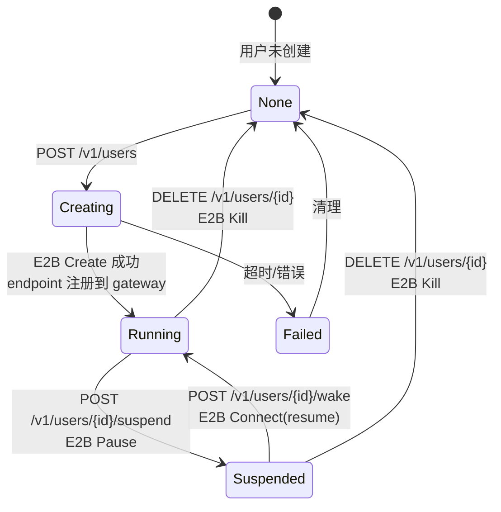

# cloudeagent · 多租户云端 AI 编码 Agent 平台

> 每个用户一个独立沙箱，沙箱里跑一个 AI 编码 Agent。控制面负责生命周期，数据面负责对话转发，前端负责交互。

cloudeagent 是一个面向多租户的云端 AI 编码 Agent 平台。用户登录后，系统在 Kubernetes 中为其创建一个隔离的沙箱（Sandbox），沙箱内运行 agent-runtime + QwenPaw ACP 内核，用户可以像使用本地 IDE 一样在浏览器里写代码、跑命令、管理文件。

平台采用 **控制面 / 数据面分离** 架构：控制面（control-plane）只管"沙箱的生老病死"，数据面（cloud-gateway）只管"对话和文件的转发"，两者通过注册中心解耦，互不阻塞。

---

## 整体架构



**数据流向：**
1. 用户在前端点击"创建实例" → 控制面调用 E2B SDK `Create` → OpenKruise 从预热池 `agent-pool` 领取一个 Sandbox
2. 控制面把沙箱的 endpoint（`http://sandbox-gateway/sandboxes/<id>/port/18585`）注册到 cloud-gateway
3. 用户发消息 → 前端 → cloud-gateway → sandbox-gateway → 沙箱内 agent-runtime → QwenPaw 执行
4. 用户离开 → 控制面 `Pause` 冻结沙箱（释放 CPU/内存，保留工作区）
5. 用户回来 → 控制面 `Resume` 唤醒，重新注入模型配置

---

## 核心组件

| 组件 | 目录 | 语言 | 职责 |
| --- | --- | --- | --- |
| **cloud-web** | [`cloud-web/`](cloud-web/) | TypeScript / React | 前端控制台：编辑器、终端、文件树、会话历史 |
| **control-plane** | [`cloud-backend/cmd/control-plane/`](cloud-backend/cmd/control-plane/) | Go | 控制面：用户/实例 CRUD、鉴权、休眠唤醒、配置注入、评审 |
| **control-plane-e2b** | [`cloud-backend/cmd/control-plane-e2b/`](cloud-backend/cmd/control-plane-e2b/) | Go | E2B 路线入口：用 OpenKruise Agents E2B SDK 管理沙箱生命周期 |
| **agent-runtime** | [`cloud-backend/cmd/agent-runtime/`](cloud-backend/cmd/agent-runtime/) | Go | 沙箱内运行时：HTTP/WS 服务，对接 QwenPaw ACP，执行命令/读写文件 |
| **cloud-gateway** | [`cloud-gateway/`](cloud-gateway/) | Go | 数据面网关：backend 注册 endpoint，前端对话/文件全部经此转发 |

### InstanceBackend 抽象

控制面不直接操作 K8s，而是通过 `InstanceBackend` 接口抽象沙箱生命周期：

```go
type InstanceBackend interface {
    Create(ctx, userID) (*Info, error)   // 创建/领取沙箱
    Start(ctx, userID) (*Info, error)    // 唤醒（resume）
    Stop(ctx, userID) error              // 休眠（pause）
    Delete(ctx, userID) error            // 销毁（kill）
    Seed(map[string]string)              // 启动时恢复 userID→sandboxID 映射
}
```

目前有两种实现：
- **`e2b.go`**（推荐）：全 E2B SDK，不直接操作 K8s CRD，生命周期走 `Create/Connect/Pause/Kill`
- **`process.go` / `docker.go`**：本地开发用，直接起进程或 Docker 容器

---

## 沙箱生命周期



**关键设计：**
- **预热池（SandboxSet）**：提前创建 N 个空闲沙箱，用户创建时直接领取，秒级响应
- **休眠即丢凭证**：模型 API Key 只驻留内存和 emptyDir，Pause 后自动丢弃，唤醒时重新注入
- **空闲回收（Reaper）**：可配置空闲超时，超时自动 Pause 释放资源

---

## 快速开始

### 前置依赖

- Go 1.21+
- Node.js 18+
- Docker（本地开发）或 Kubernetes + OpenKruise Agents（生产）

### 1. 启动数据面网关

```bash
cd cloud-gateway
go build -o bin/gateway ./cmd/gateway
./bin/gateway --listen 127.0.0.1:18500
```

### 2. 启动控制面（本地开发模式）

```bash
cd cloud-backend
go build -o bin/control-plane ./cmd/control-plane
./bin/control-plane \
  --listen :18090 \
  --store memory \
  --gateway http://127.0.0.1:18500 \
  --admin-token dev-admin-token
```

### 3. 启动控制面（E2B / OpenKruise 模式）

```bash
cd cloud-backend
go build -o bin/control-plane-e2b ./cmd/control-plane-e2b
./bin/control-plane-e2b \
  --listen :18090 \
  --store memory \
  --gateway http://127.0.0.1:18500 \
  --e2b-api-url http://sandbox-manager:8080 \
  --e2b-sandbox-base-url http://sandbox-gateway:7788 \
  --e2b-api-key <your-e2b-key> \
  --e2b-template agent-pool \
  --admin-token dev-admin-token
```

### 4. 启动前端

```bash
cd cloud-web
npm install
npm run dev   # http://localhost:5173
```

### 5. 端到端验证

```bash
# 创建用户（领取沙箱）
curl -X POST http://127.0.0.1:18090/v1/users \
  -H "Authorization: Bearer dev-admin-token" \
  -H "Content-Type: application/json" \
  -d '{"id":"alice"}'

# 休眠
curl -X POST http://127.0.0.1:18090/v1/users/alice/suspend \
  -H "Authorization: Bearer dev-admin-token"

# 唤醒
curl -X POST http://127.0.0.1:18090/v1/users/alice/wake \
  -H "Authorization: Bearer dev-admin-token"

# 销毁
curl -X DELETE http://127.0.0.1:18090/v1/users/alice \
  -H "Authorization: Bearer dev-admin-token"
```

---

## OpenKruise Agents / E2B 部署

生产环境基于 [OpenKruise Agents](https://openkruise.io/zh/kruiseagents/installation)，每个用户一个 Sandbox：

1. **安装控制面**：`agents-sandbox-controller` + `agents-sandbox-manager` + `sandbox-gateway`
2. **建预热池**：创建 `SandboxSet agent-pool`，template 里指定 agent 镜像
3. **control-plane-e2b** 通过 E2B SDK 调 manager，不直接操作 K8s CRD
4. 数据面走 `sandbox-gateway`，按 `sandboxID` 路由到对应 Pod

沙箱镜像基于 alpine，内置 `agent-runtime` 二进制，监听 `0.0.0.0:18585`。

---

## 目录结构

```
cloudeagent/
├── cloud-backend/          # 控制面 + 沙箱运行时（Go）
│   ├── cmd/
│   │   ├── control-plane/      # 旧版入口（process/docker backend）
│   │   ├── control-plane-e2b/  # E2B 入口（推荐）
│   │   └── agent-runtime/      # 沙箱内运行时
│   ├── internal/
│   │   ├── backend/            # InstanceBackend 抽象 + e2b/process/docker 实现
│   │   ├── controlplane/       # 状态机、鉴权、评审、Reaper
│   │   ├── gateway/            # cloud-gateway 客户端
│   │   ├── models/             # 数据模型
│   │   ├── store/              # PostgreSQL / Memory 存储
│   │   └── agent/              # ACP 客户端、LLM、会话
│   └── docs/                   # 架构文档
├── cloud-gateway/          # 数据面网关（Go）
└── cloud-web/              # 前端控制台（React + TS）
```

---

## 设计原则

- **控制面不直连沙箱**：所有对话/文件走 cloud-gateway，控制面只做生命周期和配置
- **凭证不落盘**：模型配置只在内存，休眠即丢，唤醒重注
- **后端可插拔**：`InstanceBackend` 接口让本地（process/docker）和生产（E2B/K8s）共用同一套控制面逻辑
- **预热池秒级创建**：SandboxSet 提前准备空闲沙箱，用户无感知等待

详细设计见 [`cloud-backend/docs/architecture.md`](cloud-backend/docs/architecture.md)。
